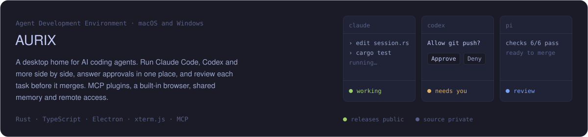
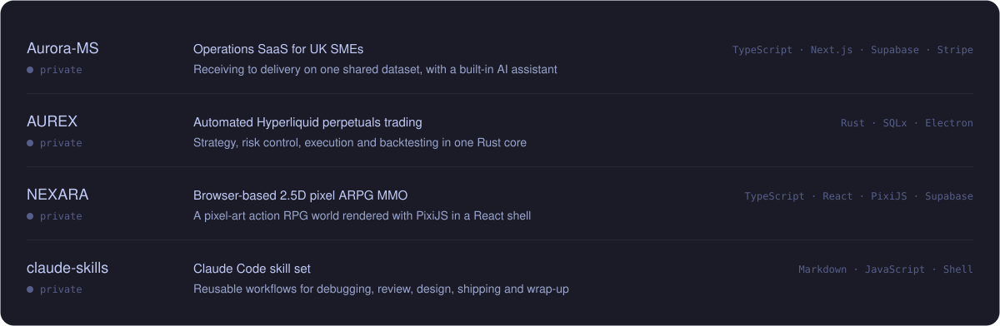

I build production systems across the whole stack: **TypeScript** web apps, **Rust** daemons and trading engines,
and the tooling that lets **AI agents** work on them safely.

## Featured

## Projects

Most source is private. AURIX installers and release notes are public at <a href="https://github.com/aiexkwan/aurix-releases">aiexkwan/aurix-releases</a>.

## Toolbox

| | |
|:--|:--|
| Web | `Next.js` `React` `TypeScript` `Tailwind` `TanStack Query` |
| Backend | `Supabase` `PostgreSQL` `Stripe` |
| Systems | `Rust` `SQLx` `Bun` |
| Desktop | `Electron` `Swift` `PixiJS` |
| AI | `Claude Code` `MCP` `Vercel AI SDK` `OpenRouter` |

## Connect

[GitHub](https://github.com/aiexkwan) · [Email](mailto:alexanderkcc1112@gmail.com)
