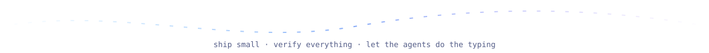

  

  
  
  

 

I build production systems across the whole stack — **TypeScript** web apps, **Rust** daemons and trading engines,
and the tooling that lets **AI agents** work on them safely.

 

## ✦ Featured

## ✦ Projects

  
  

  
  

Most source is private. AURIX installers and release notes are public at <a href="https://github.com/aiexkwan/aurix-releases">aiexkwan/aurix-releases</a>.

## ✦ Toolbox

| | |
|:--|:--|
| **Web** |      |
| **Backend** |    |
| **Systems** |    |
| **Desktop** |    |
| **AI** |     |

 

## ✦ Connect

  
  

  

